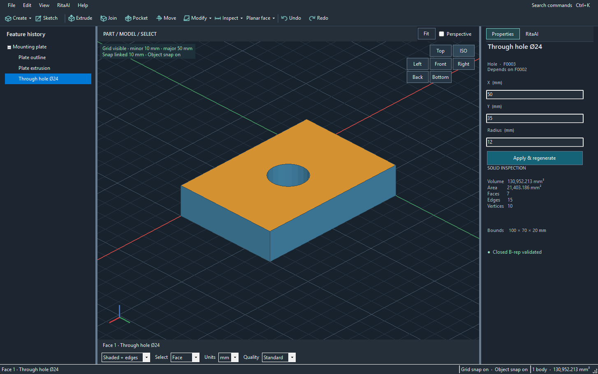

# RitaCAD

RitaCAD is a Windows parametric part modeler from Ritagyan Systems. Its analytic geometry kernel builds editable sketches and features. RitaAI can inspect the active part, guide a modeling lesson, or turn a supported design brief into a native feature preview.

## Download 0.6 RC1

[Download RitaCAD 0.6 RC1 for Windows x64](https://raw.githubusercontent.com/ivs-kartikeya/RitaCAD/main/downloads/v0.6-rc1/RitaCAD-v0.6-rc1-Windows-Portable.zip)

1. Choose **Extract All** on the downloaded ZIP.
2. Open the extracted **RitaCAD** folder and run **RitaCAD.exe**.
3. Open a native example in **samples/evolve** to inspect its editable feature history.

The portable build requires Windows x64, .NET Framework 4.8 and OpenGL support from the display driver. The examples, core CAD tools, deterministic Designer recipes and Teacher lessons work offline. Optional model inference uses a separately installed local service.

Use the named Windows Portable ZIP above for installation. GitHub's **Code → Download ZIP** downloads a snapshot of this documentation repository.

## Guides

- [Getting started](docs/GETTING_STARTED.md)
- [Optional local AI setup](docs/LOCAL_AI_SETUP.md)
- [Known limitations](docs/KNOWN_LIMITATIONS.md)
- [0.6 RC1 release notes](docs/RELEASE_NOTES_0_6.md)
- [Operation EVOLVE verification report](docs/EVOLVE_REPORT.md)
- [Previous RitaAI diagnostic report](docs/RITAAI_DIAGNOSTIC_REPORT.md)

This repository hosts downloads, guides and issue tracking. The application and RGK source are private. [Download terms](LICENSE.md) · [Report a bug](https://github.com/ivs-kartikeya/RitaCAD/issues/new?template=bug_report.yml)
