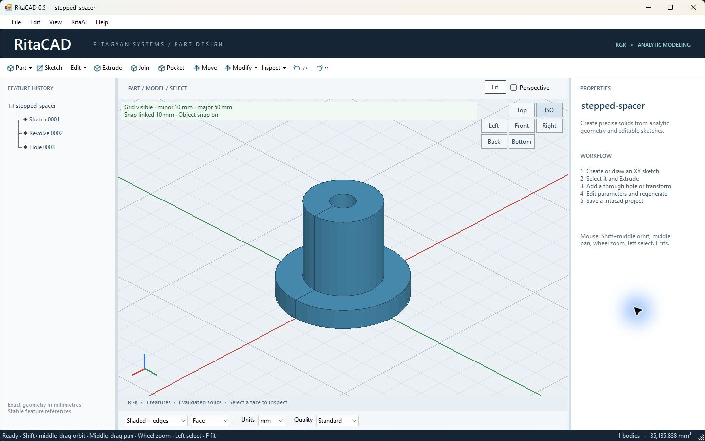
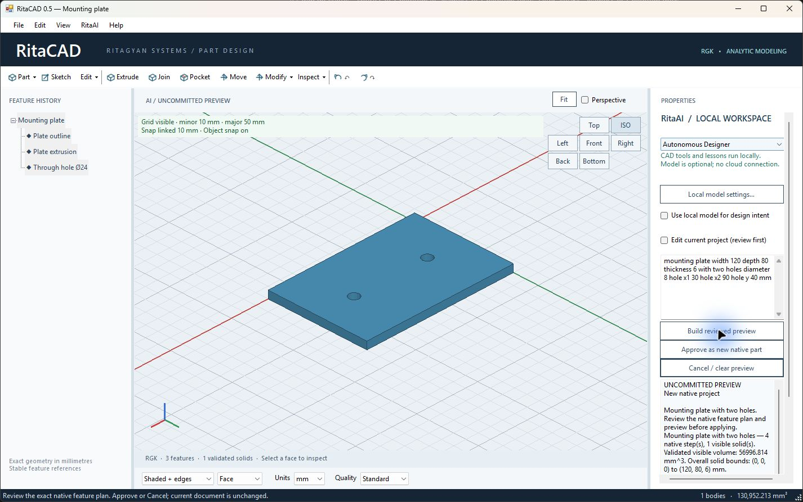

# RitaCAD

**Editable parametric parts. Local tools for learning and design.**

<kbd>v0.5-rc2</kbd> <kbd>Windows x64</kbd> <kbd>Native parametric CAD</kbd> <kbd>Optional local AI</kbd>

RitaCAD is an early Windows desktop part modeler developed under **Ritagyan Systems**, powered by the proprietary **RitaCAD Geometry Kernel (RGK)**. Sketches, dimensions and features form an editable native model; viewport triangles and STL exports are separate from that model.

**[Download for Windows →](https://github.com/ivs-kartikeya/RitaCAD/releases/download/v0.5-rc2/RitaCAD-v0.5-Windows-Portable.zip)** · [Release notes and checksums](https://github.com/ivs-kartikeya/RitaCAD/releases/tag/v0.5-rc2) · [Getting started](docs/GETTING_STARTED.md)

**This is an early release candidate.** It covers specific, validated modeling workflows and remains under active development. Read the [known limitations](docs/KNOWN_LIMITATIONS.md) before choosing it for a project.

**AI diagnostic repair update:** corrected intent/dimension grounding, single-hole and solid-shaft requests, lesson grading, saved model settings and unnecessary inference. Read the [diagnostic report](docs/RITAAI_DIAGNOSTIC_REPORT.md) and [measured results](evidence/AI_DIAGNOSTICS.json). CPU-only operation was tested with four inference threads on a fast host; ordinary 8 GB student-laptop performance remains unverified.



## Start with a real editable part

1. Download the portable ZIP, right-click it and choose **Extract All**.
2. Open the extracted folder and double-click **RitaCAD.exe**.
3. Choose **File > Open** and open a project in **samples/v05**.
4. Inspect the feature history, edit a dimension, then save your own **.ritacad** copy.

Requires **64-bit Windows, .NET Framework 4.8 and working OpenGL support**. Build tools are unnecessary. Keep the extracted folder together. Ordinary CAD, lessons and deterministic design recipes work without a language model.

Choose the named **Windows-Portable.zip** release asset. GitHub's automatic **Source code** archives and **Code > Download ZIP** contain this documentation repository, not the RitaCAD application.

## What you can try

| Workflow | Current scope |
| --- | --- |
| Sketch and model | Dimensioned sketches, extrusion, full revolve, transforms and native feature history |
| Supported part edits | Rectangular face pads/pockets, bounded prism through-bores and eligible coaxial bores |
| Inspect and learn | Computed model facts and eight original lessons in RitaAI |
| Design from a brief | Bounded plate/block, spacer/shaft and pedestal recipes and a supported two-hole edit, with a reviewed preview before approval |
| Save and share | Editable `.ritacad` projects, STL export and viewport images |

The included native examples are a **two-hole mounting plate**, **stepped spacer** and **pedestal with a pad and pocket**. They were saved, reopened and parameter-edited during release verification.

## RitaAI: inspect, learn, design

- **Engineering Copilot** answers bounded questions about computed dimensions, bounds, volume, dependencies and sketch diagnostics. It is rule-based, without conversation memory.
- **CAD Teacher** checks actual native model state against eight stated exercises, with hints and matching-feature selection.
- **Autonomous Designer** turns supported, complete briefs into editable native sketches and features. Review the isolated preview, then approve or cancel.



For example, try this in Designer:

```text
mounting plate width 120 depth 80 thickness 6 hole diameter 8 hole x1 30 hole x2 90 hole y 40 mm
```

Simple supported briefs use deterministic rules. A separately installed, reviewed local language model can optionally interpret other wording. The model and runtime are **not bundled**, and RitaCAD does not download them or use a cloud fallback. See the [RitaAI guide](docs/RITAAI.md).

## Release evidence and limits

The v0.5 application passed **416/416 software tests** in the repaired Windows development build. This public download carries the verified repaired executable. The portable application was also launched on Windows and used to open a native sample and inspect it with Copilot. These are release checks on one machine, not cross-device certification.

The optional local-model evaluation passed **13 of 14 fixed briefs**. Incorrect model output was rejected; no incorrect solid from those failures was committed. That small evaluation does not establish general engineering-language reliability.

RitaCAD does not provide general solid Booleans, assemblies, STEP interchange, arbitrary edge blends, loft/sweep or FEA. The introductory datum/GD&T lesson teaches concepts; it does not certify ASME or ISO compliance. Full details are in [known limitations](docs/KNOWN_LIMITATIONS.md).

## Downloads, feedback and terms

This repository hosts **public downloads, user documentation and issue tracking**. RitaCAD application source and RGK source remain private. Use is governed by the [download license terms](LICENSE.md).

Found a problem? [Report a bug](https://github.com/ivs-kartikeya/RitaCAD/issues/new?template=bug_report.yml) with the release version, steps and expected result. For an improvement, [request a feature](https://github.com/ivs-kartikeya/RitaCAD/issues/new?template=feature_request.yml). Please read the [contribution guide](.github/CONTRIBUTING.md) before sharing files.
